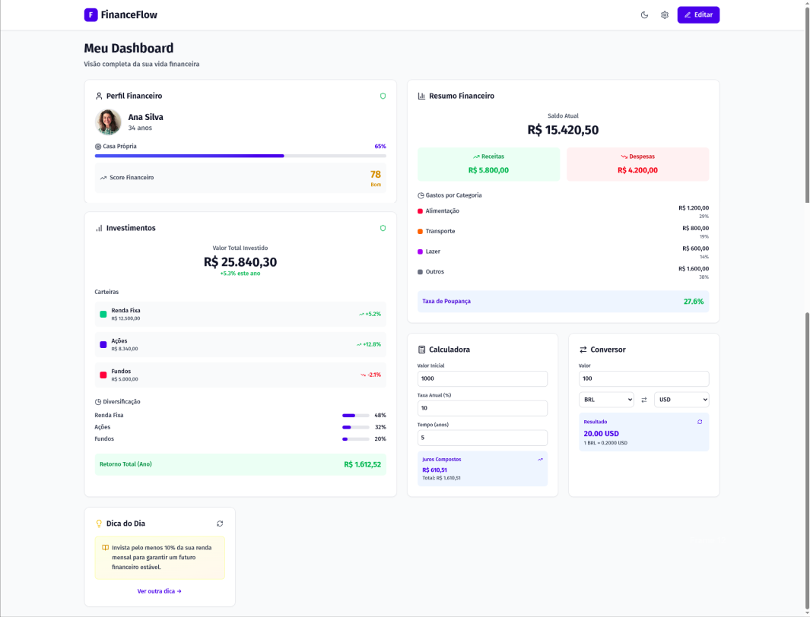
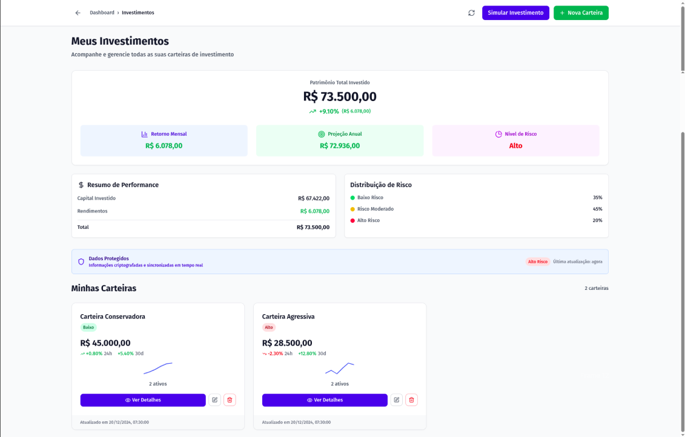

# Investir por Conta

  

---

 Inflação, juros altos e um estado que consome cada vez mais não vão embora tão cedo. Esperar pelo governo é um plano ruim. A sua independência financeira começa com você e com as suas próprias escolhas. <strong>Investir por Conta</strong> é um software independente, feito no Brasil para quem decidiu não esperar.

---

- [Sobre o Investir por Conta](#sobre-o-investir-por-conta)
  - [Propósito](#propósito)
- [Funcionalidades](#funcionalidades)
- [Para quem é?](#para-quem-é)
- [Primeiros Passos](#primeiros-passos)
- [Contribuindo](#contribuindo)
- [Licença](#licença)
- [Precisa de ajuda?](#precisa-de-ajuda)

---

## Sobre o Investir por Conta

	

**Investir por Conta** é um SaaS web de gestão financeira pessoal focado em clareza, simplicidade e sensação de controle. Ele ajuda você a acompanhar receitas e despesas para gastar menos e guardar mais — sem complicação.

Suporta:

- Registro de receitas e despesas
- Categorias e orçamentos
- Relatórios financeiros visuais
- Resumos semanais por e-mail
- Metas de economia

O Investir por Conta entrega **clareza** e **controle** sobre as suas finanças.

---

### Propósito

  

Gestão financeira pessoal é complexa, e cada pessoa a enfrenta de um jeito diferente.

O Investir por Conta parte de um princípio simples:

> Se você sabe para onde o seu dinheiro vai, você pode fazer ele ir para outro lugar.

Ao acompanhar receitas e despesas, você consegue:

- Criar orçamentos mais realistas
- Economizar de forma consistente
- Sair do ciclo de viver de salário em salário

---

## Funcionalidades

### Funcionalidades principais

- Interface minimalista e intuitiva
- Onboarding guiado em menos de 3 minutos
- Registro manual de transações (sem necessidade de integração bancária)

### Funcionalidades avançadas

- Categorias e subcategorias personalizadas
- Orçamentos mensais com alertas de limite
- Metas de economia com acompanhamento visual

### Sistema financeiro

- Registro de receitas e despesas
- Relatórios mensais e anuais
- Indicadores de progresso financeiro

### Extras

- Autenticação segura com dois fatores 🔒
- Resumo semanal por e-mail
- Micro recompensas visuais para criação de hábito financeiro

### Usabilidade

- Dashboard claro e objetivo
- Navegação simples, sem curva de aprendizado
- Gráficos e visualizações acessíveis

---

## Para quem é?

Esta aplicação é para pessoas que:

- Querem organizar as finanças de forma privada e simples
- Buscam clareza, não complexidade
- Estão cansadas de apps genéricos que não criam hábito

---

## Primeiros Passos

Você pode começar a usar o Investir por Conta de forma rápida:

1. [Acesse a demonstração](https://investirporconta.com.br/demo) _(em breve)_
2. [Crie sua conta gratuita](https://investirporconta.com.br/cadastro) _(em breve)_

---

## Contribuindo

Formas de contribuir:

- Abra issues com sugestões ou bugs
- Proponha melhorias de UX ou novas funcionalidades
- Contribua com código

Contato:

- [GitHub Issues](https://github.com/gabrielpiomachado/investir-por-conta/issues)

Diretrizes:

- [Guia de contribuição](https://github.com/gabrielpiomachado/investir-por-conta/blob/main/CONTRIBUTING.md) _(em breve)_
- [Código de conduta](https://github.com/gabrielpiomachado/investir-por-conta/blob/main/CODE_OF_CONDUCT.md) _(em breve)_

---

## Licença

Licenciado sob:

- [MIT License](https://github.com/gabrielpiomachado/investir-por-conta/blob/main/LICENSE)

---

## Precisa de ajuda?

Canais de suporte:

- [GitHub Discussions](https://github.com/gabrielpiomachado/investir-por-conta/discussions)
- [GitHub Issues](https://github.com/gabrielpiomachado/investir-por-conta/issues)
